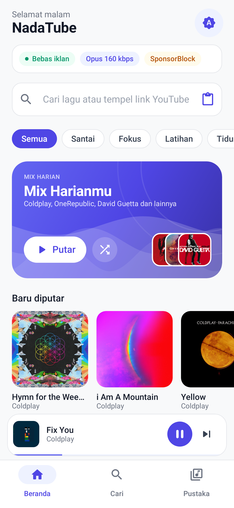
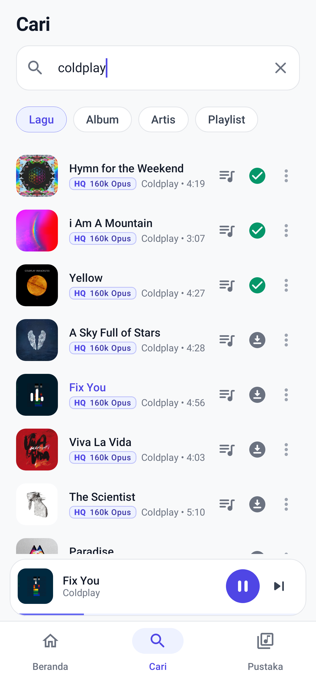
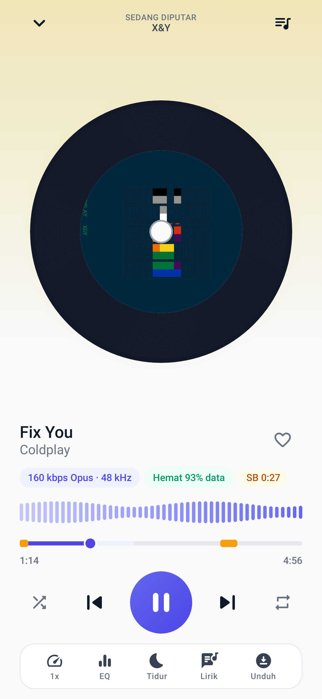
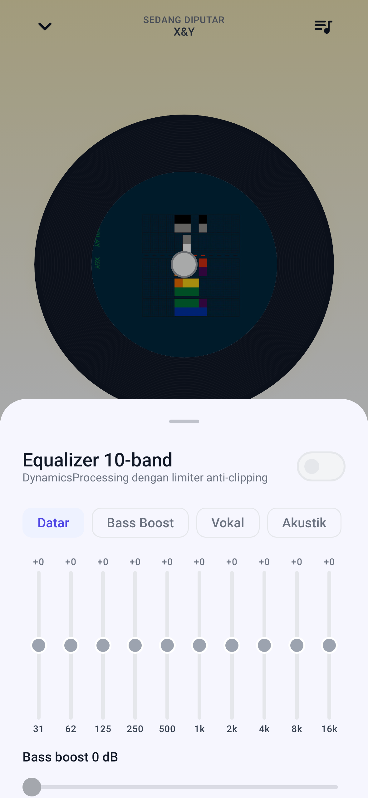
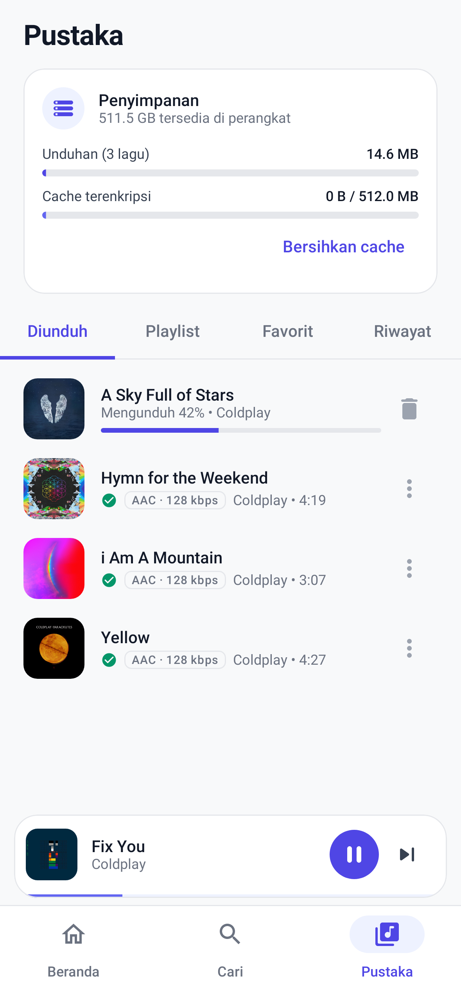
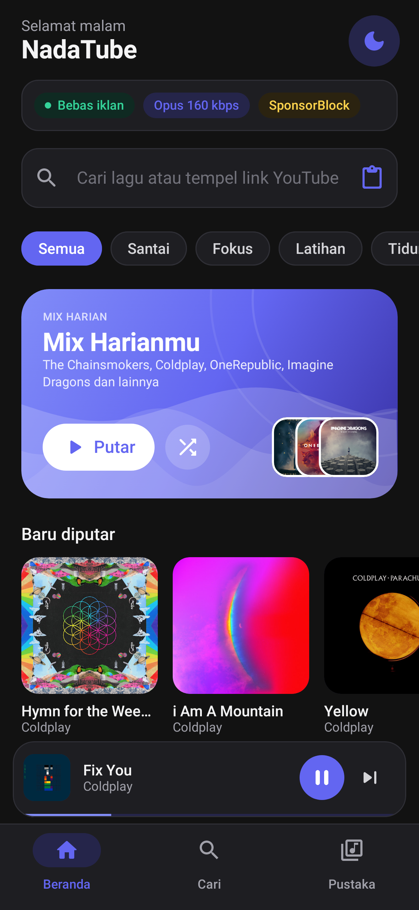
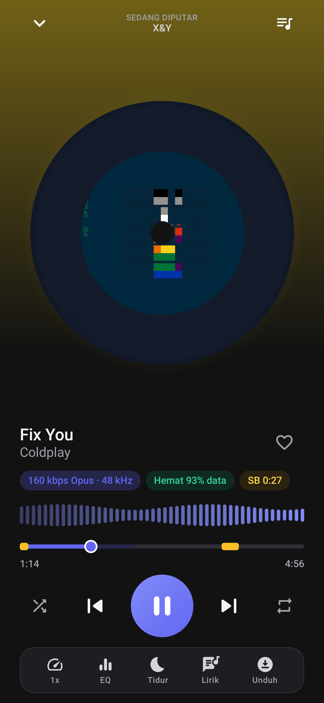
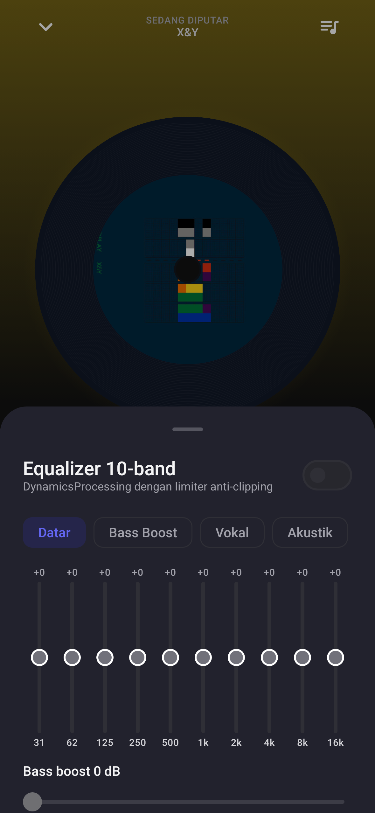
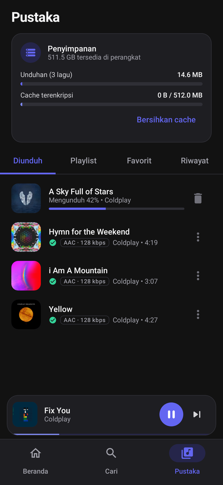

# NadaTube

Pemutar YouTube **audio-only**, bebas iklan, kualitas tinggi — untuk Android 8.0+ (API 26–34).

## Fitur

- **Audio stream extractor** — klien InnerTube minimal (`ANDROID_VR` untuk stream, `WEB_REMIX`/YouTube Music untuk metadata). Hanya stream audio yang diambil (Opus 160 kbps/48 kHz atau AAC), sehingga tidak ada byte video maupun iklan video yang diunduh (~94% lebih hemat dibanding 720p).
- **SponsorBlock** — otomatis melewati sponsor, intro, outro, promosi diri, ajakan subscribe, dan bagian non-musik; segmen ditandai pada seekbar.
- **Pencarian** lagu, artis, album, dan playlist publik; tempel/bagikan link YouTube untuk langsung memutar.
- **Pemutaran latar** dengan Media3 `MediaSessionService`: notifikasi MediaStyle, kontrol lockscreen, tombol headset/Bluetooth.
- **Equalizer 10-band** (DynamicsProcessing + limiter, fallback Equalizer di API 26–27), bass boost, **normalisasi volume** berbasis data loudness YouTube.
- Shuffle, repeat, kecepatan 0.5×–2.0×, **sleep timer** dengan fade-out, lirik tersinkron (LRCLIB), visualizer dari PCM asli (tanpa izin mikrofon).
- **Offline** — cache audio otomatis terenkripsi AES (chunked, LRU 512 MB); unduhan `.m4a` dengan tag iTunes/MP4 (judul, artis, album, cover art) atau `.webm` (Opus).
- **Room DB** — playlist lokal, favorit, riwayat, status unduhan.

## Arsitektur

```
extractor/    InnerTubeClient, InnerTubeParser (murni, teruji), AudioStreamSelector, StreamResolver, YouTubeUrlParser
sponsorblock/ SponsorBlockClient, SponsorSkipLogic
lyrics/       LyricsClient (LRCLIB), LrcParser, TitleCleaner
playback/     PlaybackService (ExoPlayer + MediaSession), PlayerConnection (MediaController),
              AudioEffectsController, EqualizerPresets/LoudnessNormalizer, VisualizerSink, SleepTimer
data/         Room (tracks, history, playlists, downloads), LibraryRepository, SettingsStore
download/     DownloadWorker (WorkManager, unduhan chunked), Mp4TagWriter, OfflineModels
ui/           Compose Material 3: Beranda, Cari, Pemutar, Pustaka, Koleksi
```

## Build & test

```bash
./gradlew testDebugUnitTest      # unit test (fixture respons InnerTube asli)
./gradlew assembleDebug          # app/build/outputs/apk/debug/app-debug.apk
NADATUBE_LIVE=1 ./gradlew testDebugUnitTest --tests '*LiveSmokeTest*'   # uji ke layanan asli
```

Catatan: YouTube kadang meminta verifikasi "bukan bot" untuk sebagian lagu bila diakses dari IP datacenter (CI/server). Di jaringan seluler/rumah hal ini jarang terjadi.

## Tampilan

Tema **Terang**, **Gelap**, atau **Ikuti Sistem** (ikon di header Beranda). Pilihan tersimpan.

| Beranda | Cari | Pemutar | Equalizer | Pustaka |
|---|---|---|---|---|
|  |  |  |  |  |
|  | |  |  |  |

Dirender dari layar asli dengan data YouTube live via Robolectric: `NADATUBE_SCREENSHOTS=1 ./gradlew testDebugUnitTest --tests '*ScreenRenderTest*'`
